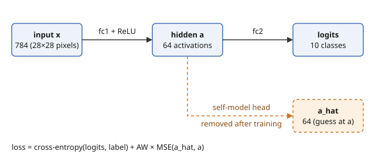

# Self-Modelling

This is a hands-on exploration of the paper **[Unexpected Benefits of Self-Modeling in Neural Systems](https://arxiv.org/abs/2407.10188)** (Premakumar et al., 2024). It's a fun side project for understanding how self-modelling works by reproducing it.

## The idea in brief

A network is given a second job: besides classifying its input, it also has to **predict its own hidden-layer activations**. The paper claims this makes the network **simpler**. Its weights get more regular, and it becomes easier to predict.

In the code:

```
loss = classification_loss + AW × self_prediction_error
```

**AW** (auxiliary weight) sets how much the network cares about modelling itself. After training, the self-prediction head is removed, so a self-modelling network can be compared directly with an ordinary one.

The two ways we measure complexity:
- **Weight SD:** the spread of the output layer's weights. Lower means simpler.
- **RLCT** (local learning coefficient): a complexity measure from singular learning theory. It's estimated with SGLD: let the weights wander randomly near the trained solution and see how fast the loss goes up. Lower means simpler.



## Project layout

```
README.md                  ← start here
LICENSE                    MIT
docs/figures/              figures used in this README
requirements.txt           dependencies (CPU-only PyTorch)
data/MNIST/raw/            MNIST dataset (downloaded automatically)
Implementations/MNIST/
    mnist_h64.py           step 1: train the baseline and the self-modelling models (64 hidden units)
    mnist_h128.py          step 1 again, with 128 hidden units
    complexity.py          step 2: measure weight SD and RLCT of the trained models
    results/               outputs of both steps
```

**About `data/MNIST/raw/`:** it holds 4 datasets (train images, train labels, test images, test labels). Each one appears twice: the `.gz` file torchvision downloaded, and the unpacked copy it actually reads.

**About `results/`:** file names follow `h<hidden size>_<model>`. For example, `h64_aw10` means 64 hidden units with AW = 10. The h128 runs write the same set of files with an `h128_` prefix.

| File | Contents |
|---|---|
| `h64_<model>.pt` | trained weights, with the self-modelling head removed (not committed; re-create with step 1) |
| `h64_<model>.json` | test accuracy, plus weight SD after each epoch |
| `h64_complexity.json` | weight SD and RLCT for every model, plus checks on whether the SGLD chains settled |
| `h64_rlct_traces.json` | raw loss at every SGLD step, for plotting or debugging RLCT |

## How to run

```bash
python3 -m venv .venv
source .venv/bin/activate
pip install -r requirements.txt

python Implementations/MNIST/mnist_h64.py     
python Implementations/MNIST/complexity.py    # needs the .pt files from step 1

# same thing with 128 hidden units
python Implementations/MNIST/mnist_h128.py
python Implementations/MNIST/complexity.py 128
```

## Results so far

MNIST only, 784 → hidden → 10 MLP, 50 epochs, single seed (0).

| Model | Acc h64 | Acc h128 | Weight SD h64 | Weight SD h128 | RLCT h64 | RLCT h128 |
|---|---|---|---|---|---|---|
| baseline | 97.6% | 98.1% | 0.571 | 0.410 | 49 | 53 |
| AW 1 | 97.3% | 97.9% | 0.598 | 0.446 | 68 | 74 |
| AW 5 | 96.6% | 97.3% | 0.521 | 0.420 | 65 | 77 |
| AW 10 | 95.7% | 96.5% | 0.484 | 0.386 | 78 | 57 |
| AW 20 | 95.7% | 96.1% | 0.461 | 0.363 | 60 | 72 |
| AW 50 | 90.1% | 94.9% | 0.316 | 0.318 | 375 ⚠️ | 48 |

**Takeaways**
- **Weight SD mostly matches the paper**, at both sizes. It falls with AW, but small AW (1, and 5 at h128) sits slightly above the baseline.
- **RLCT does not match the paper.** Almost every self-modelling model scores higher than the baseline, with no trend in AW. The one exception is h128 AW 50, just below.
- **The RLCT gaps are not SGLD noise.** The 4 chains per model agree within a few units. So either they are real for these trained nets, or the estimator is biased in the same way each time.
- **h64 AW 50's RLCT is unreliable** (0/4 chains settled). At h128 it settles fine, so that was a problem with the badly-fitting h64 net, not with AW 50 itself.
- **A wider net loses less accuracy from self-modelling** (AW 50: 94.9% at h128 vs 90.1% at h64).
- **Weight SD is still rising at epoch 50** for every model, and self-modelling nets fit the task less well (higher loss). Lower SD might partly just mean "trained less far", not "simpler".
- **This is one seed**, so the numbers are not solid evidence yet.

## Open questions / next steps

- Is the RLCT mismatch real, or does it come from how we estimate it? The paper doesn't state its β (inverse temperature), so we use 1/ln(n). The SGLD settings may also need tuning.
- Repeat the runs with several seeds to see how much the results vary.
- Check which loss the SGLD should use. A self-modelling net was trained on classification + self-prediction, so its weights are not a minimum of classification loss alone, which is what our RLCT assumes.
- Compare weight SD at matched training loss, not matched epoch, to rule out the "trained less far" explanation.
- Try more hidden sizes to cover more of the paper's Fig. 2.
- Plot the weight-SD curves and the RLCT traces.

